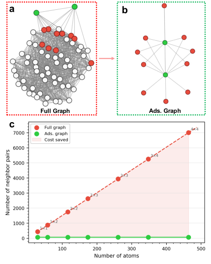
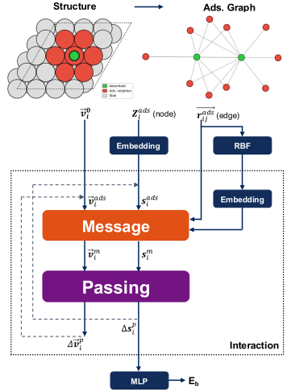

About
============

AdsNet is an equivariant graph neural network that directly predicts adsorption energies on transition metal surfaces in a single forward pass. Unlike conventional machine-learning interatomic potentials (MLIPs) that construct full-system graphs, AdsNet operates on a local adsorbate graph containing only the adsorbate atoms and their neighboring surface atoms within a cutoff radius.

Adsorbate Graph
---------------

The key of AdsNet is the use of a local adsorbate graph instead of a full graph. As shown in the example below, the full graph of a Pt 4×4×4 slab with one CO* adsorbate contains 66 nodes and 1083 edges, while the corresponding adsorbate graph contains only 12 nodes and 17 edges. This dramatically reduces computational cost, which becomes independent of the total system size.

**(a)** Full graph representation of Pt surface with CO* adsorbate. **(b)** Local adsorbate graph used by AdsNet. **(c)** Computational cost comparison showing that adsorbate graph cost is independent of system size.

Model Architecture
------------------

AdsNet implements an equivariant message-passing architecture with scalar and vector node features. The inputs are atomic numbers and interatomic vectors within the adsorbate graph. Interatomic distances are expanded using radial basis functions and modulated by a cosine cutoff envelope. After multiple interaction layers of message passing and equivariant updates, a readout MLP predicts adsorption energy contributions that are summed to obtain the total adsorption energy. Forces are computed via automatic differentiation.

The model uses equivariant message passing with scalar and vector channels over *L* interaction layers, followed by a readout MLP to predict adsorption energies.

Citation
--------

The paper is available on arXiv: `arXiv:2611.25646 <https://arxiv.org/abs/2611.25646>`_.

If you use AdsNet in your research, please cite::

    @article{ai2026adsnet,
      title         = {AdsNet: A Graph Neural Network for Direct Adsorption Energy Prediction},
      author        = {Ai, Changzhi and Abild-Pedersen, Frank and Voss, Johannes},
      year          = {2026},
      eprint        = {2611.25646},
      archivePrefix = {arXiv},
      primaryClass  = {cond-mat.mtrl-sci},
      doi           = {10.48550/arXiv.2611.25646},
      url           = {https://arxiv.org/abs/2611.25646}
    }

To cite the software itself, rather than the paper, use the archived release::

    @software{adsnet_software,
      title     = {AdsNet: A Graph Neural Network for Direct Adsorption Energy Prediction},
      author    = {Ai, Changzhi and Abild-Pedersen, Frank and Voss, Johannes},
      year      = {2026},
      publisher = {Zenodo},
      doi       = {10.5281/zenodo.24170856},
      url       = {https://doi.org/10.5281/zenodo.24170856}
    }

The AdsTraj dataset is available on `Hugging Face <https://huggingface.co/datasets/changzhiai/AdsTraj>`_,
and the trained model weights at `changzhiai/adsnet-models <https://huggingface.co/changzhiai/adsnet-models>`_.
